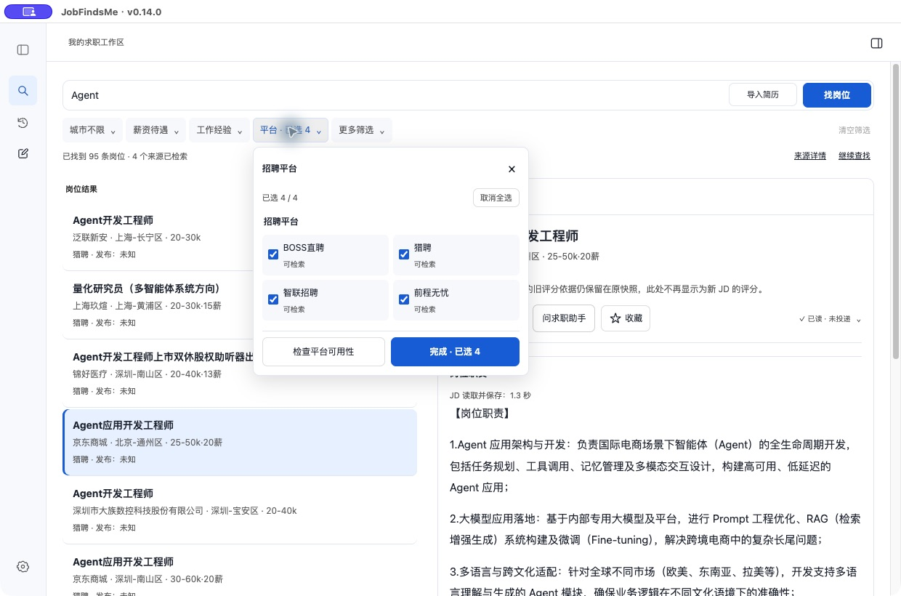
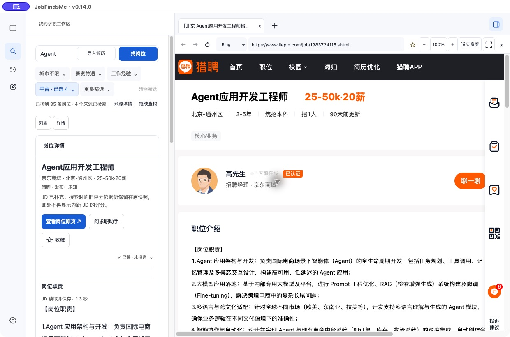
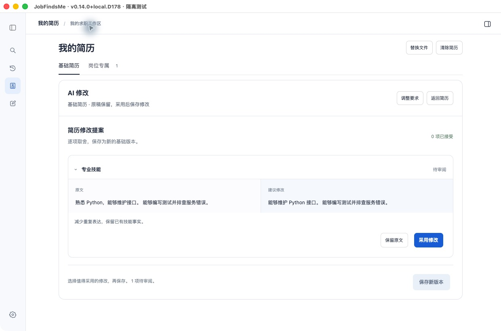
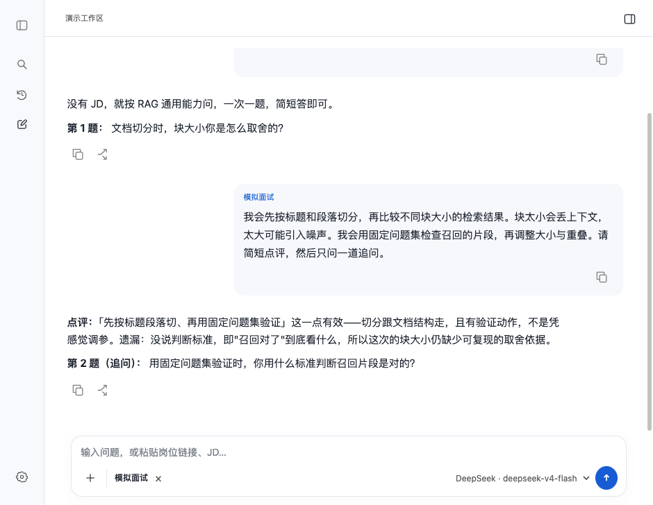
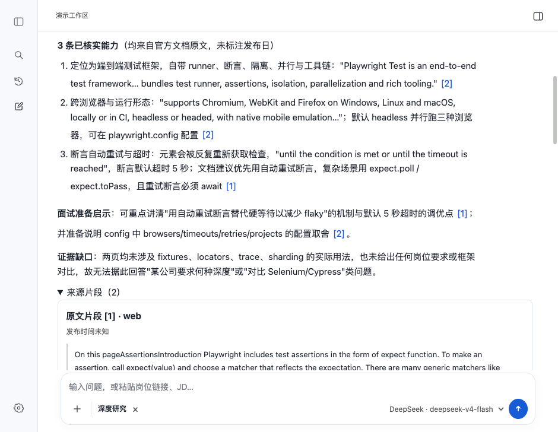

  

<h1 align="center">JobFindsMe</h1>

<strong>Find jobs. Tailor your resume. Practice interviews. One workspace.</strong> Open-source AI job-search desktop assistant · macOS / Windows

  <a href="README.md">中文</a> · <strong>English</strong>

## Four platforms, one click

Search **BOSS Zhipin, Liepin, Zhaopin and 51job** in one click, with results arriving incrementally. Filter by city, salary and experience; fetch full job descriptions when you select a role. **No model setup or resume required to search.**

## A built-in browser, right beside your jobs

Sign in, handle verification and check original sources inside the app. **Tabs, web search, bookmarks and split view** keep your workflow in one window.

Actual app screenshots. Availability depends on sign-in, verification and website changes. Results already retrieved remain available if another source fails.

## Keep your materials with the opportunity

Import your resume once. Reuse the job description and linked resume for interview preparation, with less copying and repeating.

<table>
  <tr>
    <th width="33%">Tailor your resume</th><th width="33%">Practice interviews</th><th width="33%">Deep research</th>
  </tr>
  <tr>
    <td></td>
    <td></td>
    <td></td>
  </tr>
  <tr>
    <td>Tailor to a JD in My Resume. Review each change before saving; keep your original.</td>
    <td>One question at a time, with feedback and follow-ups. No JD required.</td>
    <td>Investigate roles, companies and industries, with sources and evidence gaps.</td>
  </tr>
</table>

Click to enlarge. The resume screenshot shows the current app with fictional data and a local mock response to demonstrate review. Interview and research screenshots are from earlier versions.

- **My Resume**: preserve original PDF / Word files and extract matching information in the background. Edit copies, review AI changes, choose professional / graduate / compact layouts, and export Word or PDF.
- **Job Management**: view saved and applied jobs, reuse the linked resume, edit or polish an opening message, open the original listing, and record application materials and outcomes.
- **Assistant**: search live jobs, practice interviews and research companies. Keep separate conversations, with search, archiving and branches.

## Get started in three steps

1. **Download**: [macOS (Apple Silicon)](https://github.com/russeell/jobfindsme/releases/latest/download/mac-arm64.zip) · [Windows (x64)](https://github.com/russeell/jobfindsme/releases/latest/download/windows-x64.zip). Extract and open `JobFindsMe.app` or `JobFindsMe.exe`. No separate runtime installation needed.
2. **Search for jobs**: enter keywords, choose one city or no city restriction, select platforms and sign in or complete verification when prompted.
3. **Prepare with AI**: configure your own model in Settings. Edit your resume in My Resume; start interview preparation or research from a job or the Assistant.

Packages are unsigned. See the [release page](https://github.com/russeell/jobfindsme/releases/latest) for first-launch instructions, the exact source commit and SHA256 checksums.

Data is stored locally. AI features send relevant materials to your chosen model service, which may charge for requests. Editable PDF copies are reflowed, without guaranteed preservation of the original layout. You confirm and send applications on the platform; opening a listing does not mark it as applied.

**Disclaimer: This project is intended for learning and personal use only. Follow each platform's usage rules and independently verify job information and AI-generated output.**

[Development](docs/desktop/README.md) · [Contributing](CONTRIBUTING.md) · [Security](SECURITY.md) · [MIT license](LICENSE)
