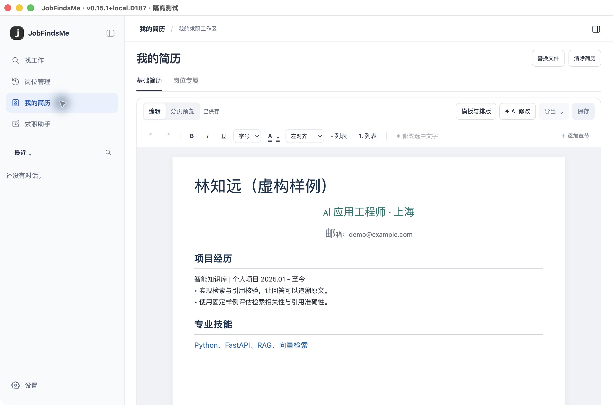

  

<h1 align="center">JobFindsMe</h1>

<strong>跨平台找岗位，把简历、面试和投递串起来。</strong> 开源 AI 求职桌面助手 · macOS / Windows · 数据保存在本机

  <a href="https://github.com/russeell/jobfindsme/releases/latest/download/mac-arm64.zip"><strong>下载 macOS（M 系列）</strong></a> ·
  <a href="https://github.com/russeell/jobfindsme/releases/latest/download/windows-x64.zip"><strong>下载 Windows（x64）</strong></a> ·
  <a href="https://github.com/russeell/jobfindsme/issues">反馈问题</a>

<strong>中文</strong> · <a href="README.en.md">English</a>

求职的时间应该花在判断机会和准备面试。JobFindsMe 把招聘网站、简历和求职材料放在一个工作台：**找到一个岗位，带着它的 JD 和你的简历继续准备，少重复搜索、粘贴和解释。**

**不用上传简历、配置模型，也能先找工作。** 需要 AI 修改、面试或背调时，再连接你自己的模型服务。

## 能帮你完成什么

| 你想做的事 | JobFindsMe 怎么帮你 |
| --- | --- |
| **找到合适的岗位** | 一次选择四个平台，统一查看结果；按城市、薪资、经验和工作类型筛选。已有简历可参与本地匹配，查看符合项、缺口和未知信息。 |
| **看清岗位原文** | 选中后按需读取 JD，在内嵌浏览器核对原页；登录、验证与准备材料都在同一个窗口。 |
| **准备更合适的简历** | 保留原文件，编辑副本；对照 JD 让 AI 提出修改，逐项审阅后保存独立版本。 |
| **练习这场面试** | 复用岗位与简历，逐题练习、点评和追问；薄弱点留作复习，没有 JD 也能开始。 |
| **了解这家公司** | 研究岗位、公司和行业，追查原文，保留引用与证据缺口。 |
| **准备投递并跟进** | 复用简历，编辑或 AI 润色招呼语，复制并打开岗位；记录实际使用的材料、投递结果和下一步。 |

## 四个平台，一次搜索

支持 **BOSS直聘、猎聘、智联招聘、前程无忧**。选择平台后一次发起检索，结果陆续出现，直接在列表与详情之间浏览。

- **按你的条件找**：城市、薪资、工作经验，以及不限 / 全职 / 兼职；经验包含在校生与应届生。
- **有简历就复用**：后台提取匹配信息，参与岗位推荐与排序；原文件保留，个人联系方式不进入检索关键词。
- **选中了再读 JD**：按需补全详情，已读材料继续复用；可继续查找后续结果。
- **看得见来源状态**：登录、验证、连接失败与部分覆盖分别说明；单个来源失败，已取得的其他结果仍可查看。

实际应用截图，来自早期版本。平台状态随账户、验证和网站变化而变化，不代表四个平台始终可用。

## 原页就在旁边，少切几个窗口

内嵌浏览器支持 **多标签、网页搜索、书签和分栏浏览**。左边看岗位和准备材料，右边打开对应招聘原页；登录、验证码与原文核对在应用内完成。

实际应用截图。能打开网页与能自动读取列表、续页或完整 JD 是不同能力，应用按实际读取结果展示状态。

## 一份简历，准备不同机会

「我的简历」是统一的维护和修改入口。导入 **PDF / DOCX** 后先看原件，匹配信息在后台提取；需要修改时，再打开可编辑副本。也支持 MD / TXT 文字导入。可读取的颜色、字号和文字样式随副本保留，原文件保持不变。

- **专注写简历**：分组工具栏提供撤销、加粗、字号、颜色、对齐和列表；选段清除格式可一次撤销。专注模式扩大编辑空间，`Esc` 返回。
- **草稿不怕中断**：未保存修改留在本机，退出重启可恢复；`⌘S / Ctrl+S` 保存后继续输入。分页预览与 Word / PDF 导出使用当前已保存内容。
- **AI 在编辑器里协助**：可收起的简历助手支持选段修改和整份优化，带入已有 JD 与经历；先看原文与建议，再决定采用。编辑过原文后，旧建议不能覆盖新内容，基础简历与岗位专属稿分开保留。
- **适合不同阶段**：社招、校招、紧凑三种排版，调整展示顺序和密度；连续分页预览，导出 Word 或 PDF。
- **随岗位复用**：关联简历继续用于面试和投递材料，不必每次重新介绍自己。

实际编辑界面（v0.15.2），使用虚构简历；展示导入样式、编辑与保存，不含用户资料。

## 面试和背调，接着这个岗位开始

从岗位进入准备，已有 JD、关联简历与保存的材料随任务带入。需要独立练习或研究时，也可以直接打开「求职助手」。

<table>
  <tr><th width="33%">修改简历</th><th width="33%">模拟面试</th><th width="33%">深度研究</th></tr>
  <tr>
    <td></td>
    <td></td>
    <td></td>
  </tr>
  <tr>
    <td>保留真实经历，审阅后保存岗位专属稿。</td>
    <td>围绕岗位练习，保存薄弱点，下次继续复习。</td>
    <td>追查原文，分清有依据的发现与尚待核实的信息。</td>
  </tr>
</table>

点击查看大图。简历图使用虚构资料与本机模拟输出，演示审阅交互；面试与研究图来自早期版本。截图不代表模型质量保证。

求职助手还支持 **多对话、图钉置顶、历史搜索、归档和分支**，不同公司与主题可以分别继续；相关材料可作为附件带入对话。

## 从收藏，到投递，再到下一步

「岗位管理」集中查看 **全部、收藏、已投递**。在列表直接安排下一步，用“今天、明天、三天后”设置日期；到期事项集中显示，支持改期、完成和撤销。

准备投递时，选好简历和招呼语；下次打开会恢复已保存的材料。常用话术可提前保存，自动带入公司与岗位；AI 润色可使用当前 JD 和明确选中的脱敏经历，结果直接编辑，也能撤销。**复制招呼语并打开岗位**后，由你在平台确认发送。

保存投递结果后，可以回看“给哪家公司用了哪份简历、什么话术、什么时候操作”，已投递岗位进入记录流程。打开原页只记为打开，**不会冒充投递成功**。应用提供辅助投递，不提供批量海投。

**BOSS 单岗位确认投递为实验功能**：恢复已选简历与招呼语，核对具体岗位、账号和实际附件后，由你确认一次执行；招呼语和附件分别核实，重复点击合并，重启后保留去重记录。遇验证、限流或结果不明会停止，不自动重发。macOS 隔离窗口的确认、停止和重启恢复，以及真实 BOSS 的只读确认预览已验证；真实上传、发送与平台回执尚未完成验收；请优先使用辅助投递，不能把确认预览通过视为实际发送成功。

## 三步开始

1. **下载安装**：[macOS（M 系列）](https://github.com/russeell/jobfindsme/releases/latest/download/mac-arm64.zip) · [Windows（x64）](https://github.com/russeell/jobfindsme/releases/latest/download/windows-x64.zip)。完整解压后打开 `JobFindsMe.app` 或 `JobFindsMe.exe`，无需另装 Python / Node.js。
2. **先找一个岗位**：输入方向，选择城市和平台，按提示登录或验证。简历可以之后再导入。
3. **再用 AI 准备**：在设置中连接自己的模型；简历修改在「我的简历」，面试和背调从岗位或「求职助手」开始。

本文介绍当前源码功能，下载版以[发布页](https://github.com/russeell/jobfindsme/releases/latest)的版本说明为准。安装包尚未签名 / 公证，首次打开方法、对应源码提交和 SHA256 校验信息均在发布页。

<strong>使用前了解这些</strong>

- **本地数据与模型**：简历、会话和记录保存在本机；使用 AI 时，所需材料会发送给你选择的模型服务，可能产生费用。简历分析与匹配使用脱敏副本，不替换原文件。
- **简历格式**：原件预览与下载保留原文件；可编辑副本保留支持的文字样式并重新排版，复杂分栏、装饰图形和原始字体不保证还原。扫描 PDF 暂无 OCR。
- **平台与结果**：登录、验证、网络和网站变化可能影响读取。岗位是否仍在招、最终薪资和 AI 输出请核对原文。
- **发送由你确认**：不会因打开岗位自动标记已投递，不提供默认无人值守海投。

**免责声明：本项目仅供学习和个人使用。请遵守相关平台的使用规则，岗位信息与 AI 输出请自行核实。**

遇到问题，请在 [Issues](https://github.com/russeell/jobfindsme/issues) 附上应用版本、平台、操作步骤和脱敏截图，帮助我们复现。

[开发说明](docs/desktop/README.md) · [贡献指南](CONTRIBUTING.md) · [安全说明](SECURITY.md) · [MIT 许可证](LICENSE)
